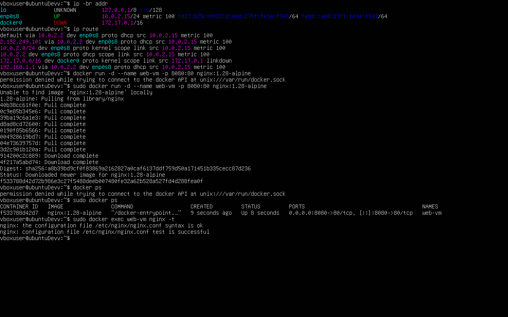

# Atelier A2 · VM Linux et conteneur web

## Objectif

Créer une VM Ubuntu Server dans VirtualBox, relever son réseau, puis lancer un conteneur Nginx pour distinguer l'adresse de la VM de celle du conteneur.

Cette VM (`UbuntuDev`) est réutilisée dans les ateliers A3, A4, B3 et B4.

## Fichiers

| Fichier | Rôle |
|---------|------|
| [`VirtualBox_ubuntuDevv_18_11_2026_12_54_19.png`](VirtualBox_ubuntuDevv_18_11_2026_12_54_19.png) | Capture de la console : relevé réseau, lancement du conteneur, test de configuration Nginx |

Aucun export de VM n'est versionné. Les réglages et la procédure ci-dessous permettent de recréer la VM.

## Prérequis

- VirtualBox (version Apple Silicon sur Mac arm64)
- ISO Ubuntu Server **arm64** (architecture de l'hôte)
- Accès Internet pour l'installation des paquets et le téléchargement de l'image Nginx

## 1. Réglages de la VM

| Paramètre | Valeur |
|-----------|--------|
| Nom | `UbuntuDev` (nom d'hôte `ubuntuDevv`) |
| Type | Linux / Ubuntu (ARM 64-bit) |
| Système invité | Ubuntu Server arm64, installation texte sans interface graphique |
| Processeurs | 2 vCPU |
| Mémoire | 2 Go |
| Disque | VDI dynamique, 20 Go demandés (le disque système apparaît en 25 Go dans `lsblk` en A4) |
| Réseau | Adaptateur 1 : NAT |
| Service | OpenSSH Server coché dans l'installateur |
| Compte | `vboxuser` (membre de `sudo`) |

Procédure :

1. VirtualBox > Nouvelle : nom `UbuntuDev`, type Linux / Ubuntu ARM 64-bit, ISO Ubuntu Server.
2. Ressources : 2 vCPU, 2 Go RAM, disque VDI dynamique de 20 Go.
3. Réseau : laisser l'adaptateur 1 en NAT.
4. Installer Ubuntu Server, cocher OpenSSH Server, créer le compte.
5. Installer Docker Engine dans l'invité en suivant la documentation officielle « Docker Engine sur Ubuntu ».

## 2. Relevé réseau

```bash
ip -br addr
ip route
```



| Interface | État | Adresse |
|-----------|------|---------|
| `lo` | UNKNOWN | 127.0.0.1/8 |
| `enp0s8` | UP | 10.0.2.15/24 (NAT VirtualBox) |
| `docker0` | DOWN | 172.17.0.1/16 |

- Route par défaut : `default via 10.0.2.2 dev enp0s8` (passerelle NAT de VirtualBox).
- `docker0` est le réseau des conteneurs : son adresse est différente de celle de la VM.

## 3. Conteneur Nginx dans la VM

```bash
sudo docker run -d --name web-vm -p 8080:80 nginx:1.28-alpine
sudo docker ps
sudo docker exec web-vm nginx -t
```

```
CONTAINER ID   IMAGE               COMMAND                  CREATED         STATUS         PORTS                                     NAMES
f533788d42d7   nginx:1.28-alpine   "/docker-entrypoint.…"   9 seconds ago   Up 8 seconds   0.0.0.0:8080->80/tcp, [::]:8080->80/tcp   web-vm
nginx: the configuration file /etc/nginx/nginx.conf syntax is ok
nginx: configuration file /etc/nginx/nginx.conf test is successful
```

**Attendu :** conteneur `web-vm` `Up`, test de configuration Nginx réussi.

Écarts par rapport à l'énoncé :

- Port **8080** utilisé au lieu de **8088**. Le port 8088 est utilisé à partir de l'atelier A3.
- `docker` sans `sudo` renvoie `permission denied while trying to connect to the docker API`. Le compte n'est pas dans le groupe `docker`, donc les commandes passent par `sudo`.

## 4. Accès depuis l'hôte (redirection de port NAT)

Avec le NAT seul, l'hôte ne joint pas la VM directement. Règle ajoutée dans VirtualBox : Configuration > Réseau > Adaptateur 1 > Avancé > Redirection de ports.

| Nom | Protocole | IP hôte | Port hôte | IP invité | Port invité |
|-----|-----------|---------|-----------|-----------|-------------|
| web | TCP | 127.0.0.1 | 8080 | 10.0.2.15 | 8080 |

Test depuis le Mac :

```bash
curl http://127.0.0.1:8080
```

```html
<!DOCTYPE html>
<html>
<head>
<title>Welcome to nginx!</title>
...
<h1>Welcome to nginx!</h1>
<p>If you see this page, the nginx web server is successfully installed and
working. Further configuration is required.</p>
...
</html>
```

**Résultat :** la page d'accueil Nginx répond depuis l'hôte.

## 5. Niveaux d'adresses

| Niveau | Adresse |
|--------|---------|
| Mac (hôte) | adresse du réseau local, `127.0.0.1` pour la redirection |
| VM (invité) | `10.0.2.15` (NAT) |
| Conteneur | `172.17.0.x` (réseau `docker0`) |

Chemin d'une requête : `127.0.0.1:8080` (hôte) → redirection VirtualBox → `10.0.2.15:8080` (VM) → publication Docker → `172.17.0.x:80` (conteneur).

## 6. Nettoyage

```bash
sudo docker rm -f web-vm
```

La VM est conservée pour les ateliers suivants. La règle de redirection `web` peut être supprimée dans VirtualBox si elle n'est plus utile.
