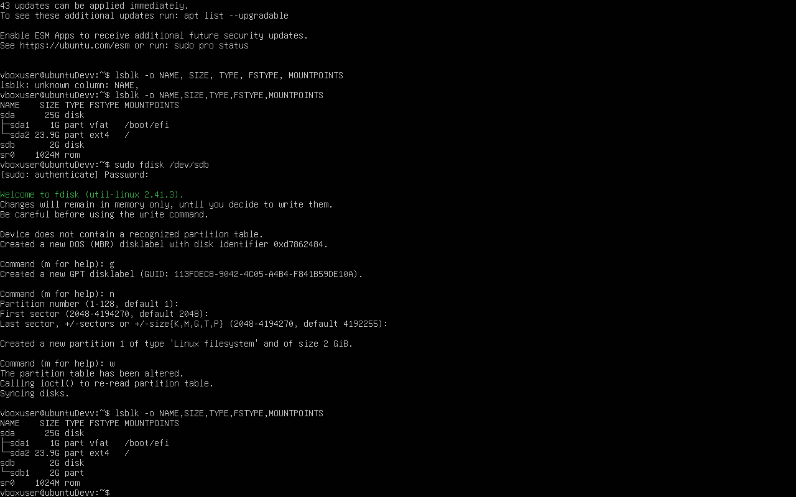

# Atelier A4 · Attacher et monter un disque

## Objectif

Ajouter un second disque virtuel à la VM, le partitionner, le formater en ext4, le monter et le rendre permanent avec `/etc/fstab`.

## Fichiers

| Fichier | Rôle |
|---------|------|
| [`fstab.extrait`](fstab.extrait) | Ligne ajoutée à `/etc/fstab` pour le montage permanent |
| [`VirtualBox_ubuntuDevv_18_11_2026_13_38_39.png`](VirtualBox_ubuntuDevv_18_11_2026_13_38_39.png) | Capture de la console : `lsblk` et partitionnement avec `fdisk` |

## Prérequis

- VM `UbuntuDev` préparée en [A2](../a2-vm-linux-conteneur-web/) (réseau de [A3](../a3-reseau-vm/) facultatif)
- VirtualBox sur l'hôte, accès à la console ou en SSH (`ssh vboxuser@192.168.56.20`)

### Réutiliser la VM de l'atelier A2

1. Arrêter `UbuntuDev` (`sudo poweroff`) : un disque s'ajoute VM arrêtée.
2. Ajouter le second disque (section 1). Le disque système et la configuration réseau ne changent pas.
3. Démarrer la VM et suivre les sections 2 à 6.

> Attention : `fdisk` et `mkfs.ext4` effacent le périphérique ciblé. Vérifier avec `lsblk` que la cible est bien le disque vide de 2 Go (`sdb` ici) et non le disque système (`sda`).

## 1. Ajout du disque (VirtualBox)

VM éteinte : Configuration > Stockage > contrôleur VirtioSCSI > nouveau disque dur **VDI**, **dynamique**, **2 Go**.

## 2. Repérer le disque

```bash
lsblk -o NAME,SIZE,TYPE,FSTYPE,MOUNTPOINTS
```

```
NAME    SIZE TYPE FSTYPE MOUNTPOINTS
sda      25G disk
├─sda1    1G part vfat   /boot/efi
└─sda2 23.9G part ext4   /
sdb       2G disk
sr0    1024M rom
```

- `sda` (25 Go) : disque système, ne pas toucher.
- `sdb` (2 Go) : nouveau disque, vide, sans partition ni montage.

## 3. Partitionnement

```bash
sudo fdisk /dev/sdb
```

Dans `fdisk` : `g` (table GPT), `n` (nouvelle partition, valeurs par défaut), `w` (écriture).



```
Welcome to fdisk (util-linux 2.41.3).
Changes will remain in memory only, until you decide to write them.
Be careful before using the write command.

Device does not contain a recognized partition table.
Created a new DOS (MBR) disklabel with disk identifier 0xd7862484.

Command (m for help): g
Created a new GPT disklabel (GUID: 113FDEC8-9042-4C05-A4B4-F841B59DE10A).

Command (m for help): n
Partition number (1-128, default 1):
First sector (2048-4194270, default 2048):
Last sector, +/-sectors or +/-size{K,M,G,T,P} (2048-4194270, default 4192255):

Created a new partition 1 of type 'Linux filesystem' and of size 2 GiB.

Command (m for help): w
The partition table has been altered.
Calling ioctl() to re-read partition table.
Syncing disks.
```

Vérification :

```bash
lsblk -o NAME,SIZE,TYPE,FSTYPE,MOUNTPOINTS
```

```
NAME    SIZE TYPE FSTYPE MOUNTPOINTS
sda      25G disk
├─sda1    1G part vfat   /boot/efi
└─sda2 23.9G part ext4   /
sdb       2G disk
└─sdb1    2G part
sr0    1024M rom
```

## 4. Formatage, montage et test

```bash
sudo mkfs.ext4 /dev/sdb1
sudo mkdir -p /mnt/lab-data
sudo mount /dev/sdb1 /mnt/lab-data
echo "Disque de test" | sudo tee /mnt/lab-data/temoin.txt
findmnt /mnt/lab-data
```

```
Disque de test
TARGET        SOURCE    FSTYPE OPTIONS
/mnt/lab-data /dev/sdb1 ext4   rw,relatime
```

Démontage, remontage et lecture du fichier témoin :

```bash
sudo umount /mnt/lab-data
sudo mount /dev/sdb1 /mnt/lab-data
cat /mnt/lab-data/temoin.txt
```

```
Disque de test
```

Le fichier réapparaît après remontage : les données sont conservées sur le disque.

## 5. Montage permanent (`/etc/fstab`)

```bash
sudo blkid /dev/sdb1
```

```
/dev/sdb1: UUID="6ebed6f6-2cf1-4488-a44b-0f5d01f158f4" BLOCK_SIZE="4096" TYPE="ext4" PARTUUID="52faafb7-6307-4187-8222-2206bec15e16"
```

Ligne ajoutée à la fin de `/etc/fstab` (`sudo nano /etc/fstab`) :

```
UUID=6ebed6f6-2cf1-4488-a44b-0f5d01f158f4  /mnt/lab-data  ext4  defaults,nofail  0  2
```

- L'UUID est utilisé plutôt que `/dev/sdb1`, car le nom du périphérique peut changer d'un démarrage à l'autre.
- `nofail` évite de bloquer le démarrage si le disque est absent.

Vérification avant redémarrage :

```bash
sudo umount /mnt/lab-data
sudo mount -a
findmnt /mnt/lab-data
```

```
mount: (hint) your fstab has been modified, but systemd still uses
       the old version; use 'systemctl daemon-reload' to reload.
TARGET        SOURCE    FSTYPE OPTIONS
/mnt/lab-data /dev/sdb1 ext4   rw,relatime
```

`mount -a` a remonté le disque depuis `fstab`. Le message d'avertissement indique que `systemd` utilise encore l'ancienne version du fichier ; on le recharge avec :

```bash
sudo systemctl daemon-reload
```

## 6. Test après redémarrage

```bash
sudo reboot
findmnt /mnt/lab-data
cat /mnt/lab-data/temoin.txt
```

**Attendu :** `/mnt/lab-data` monté depuis `/dev/sdb1` sans action manuelle, et `cat` affiche `Disque de test`.

**Statut :** étape à consigner. Le montage par `mount -a` depuis `fstab` est validé (section 5). La sortie après redémarrage reste à ajouter ici.

## 7. Nettoyage

Le disque peut rester attaché pour la suite. Pour le retirer proprement :

```bash
sudo umount /mnt/lab-data
sudo nano /etc/fstab        # supprimer la ligne UUID=6ebed6f6-...
sudo systemctl daemon-reload
sudo poweroff
```

Puis dans VirtualBox : Configuration > Stockage > retirer le disque de 2 Go, et le supprimer dans le Gestionnaire de médias si les données ne sont plus utiles.

> Retirer le disque sans supprimer la ligne `fstab` ne bloque pas le démarrage grâce à `nofail`, mais laisse une entrée inutile.
