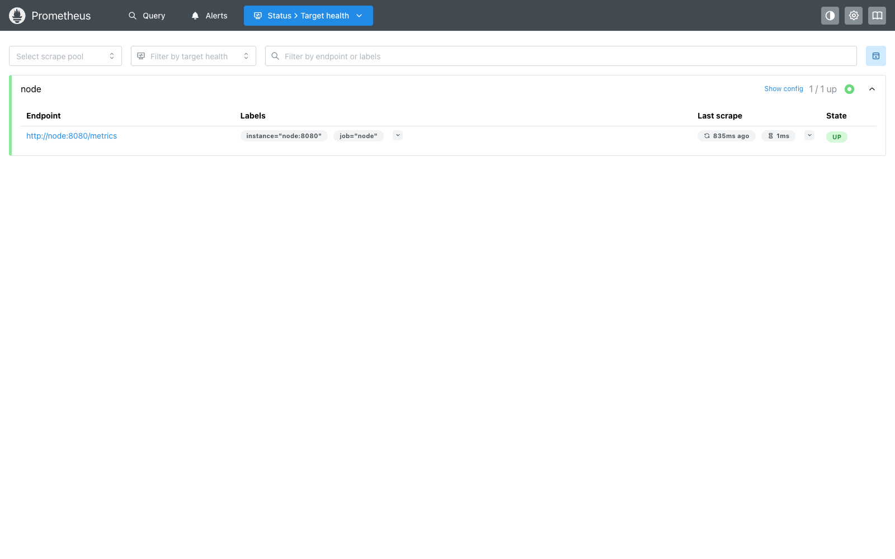
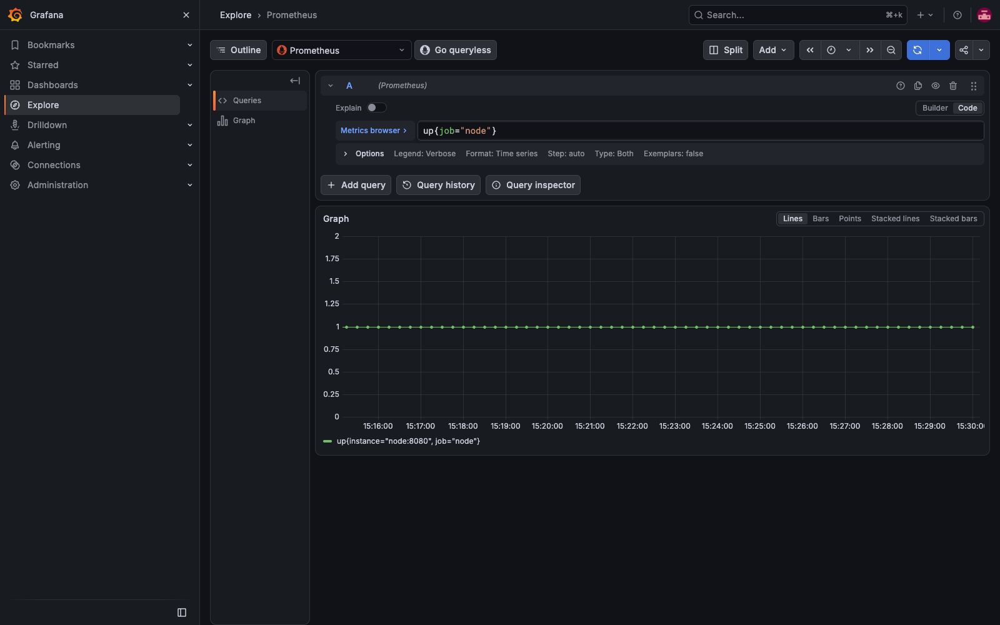
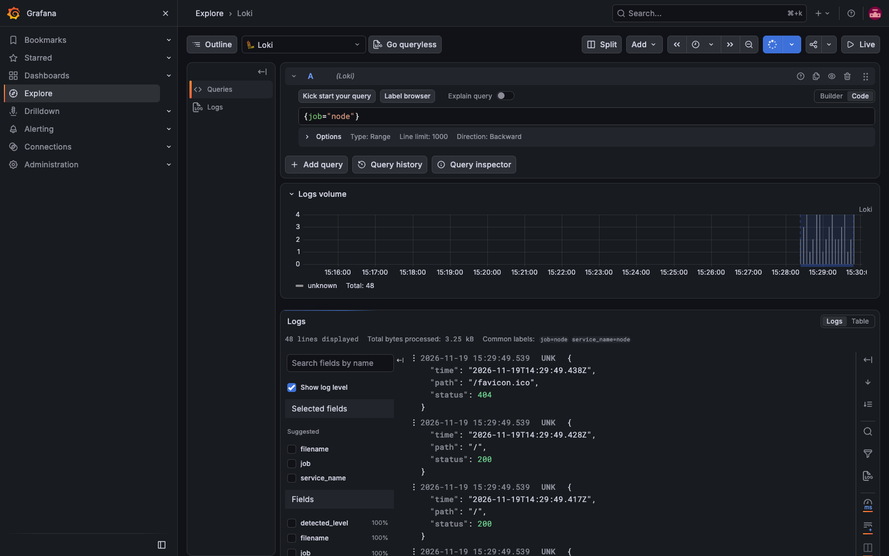
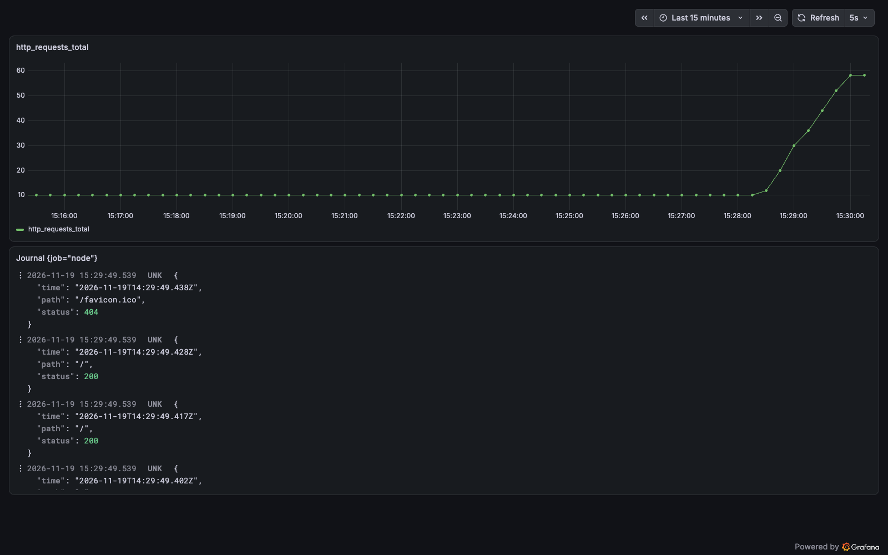

# TP3 · Superviser une application locale avec OpenTofu

## Objectif

Monter un environnement de préproduction supervisé : une application Node.js expose un compteur que **Prometheus** collecte, et écrit un journal que **Alloy** lit et envoie à **Loki**. **Grafana** affiche les deux. Toute la pile est décrite dans OpenTofu.

```
                 métriques (/metrics, toutes les 5 s)
  Prometheus  <──────────────────────────  Application Node.js
      ^                                          │ écrit /logs/http.log
      │                                          v  (volume monitoring-app_logs)
   Grafana  ─────────>  Loki  <─────────────  Alloy (lecture seule)
```

## Fichiers

| Fichier | Rôle |
|---------|------|
| [`versions.tf`](versions.tf) | Repris de la pile DevSecOps |
| [`main.tf`](main.tf) | Une table `local.services` qui décrit les 5 services, puis réseau, images, volumes et conteneurs générés avec `for_each` |
| [`outputs.tf`](outputs.tf) | URL des services publiés |
| [`app.js`](app.js) | Application : `/` répond 200, autre chemin 404, `/metrics` expose `http_requests_total` |
| [`prometheus.yml`](prometheus.yml) | Collecte de `node:8080` toutes les 5 s |
| [`loki.yaml`](loki.yaml) | Loki en une instance, stockage sur disque, schéma v13 |
| [`config.alloy`](config.alloy) | Lit `/logs/http.log` avec le label `job="node"` et pousse vers `loki:3100` |
| [`.terraform.lock.hcl`](.terraform.lock.hcl) | Verrou du fournisseur |

Pas de `terraform.tfvars` ici : la pile n'a aucune variable ni secret. Le mot de passe Grafana se choisit à la première connexion et n'est pas versionné.

| Service | Image | Port hôte | Stockage |
|---------|-------|-----------|----------|
| Application | `node:24-alpine` | 8080 | `monitoring-app_logs` sur `/logs` |
| Prometheus | `prom/prometheus:v3.16.0` | 9090 | `monitoring-prometheus` sur `/prometheus` |
| Grafana | `grafana/grafana:13.3.0` | 3000 | `monitoring-grafana` sur `/var/lib/grafana` |
| Loki | `grafana/loki:3.7.0` | 3100 | `monitoring-loki` sur `/loki` |
| Alloy | `grafana/alloy:v1.21.2` | aucun | `monitoring-app_logs` en lecture seule, `monitoring-alloy` pour sa position de lecture |

Les fichiers de configuration sont montés en lecture seule depuis ce dossier (`abspath`). Tous les ports sont publiés sur `127.0.0.1` uniquement.

## Prérequis

- Docker Desktop et OpenTofu ≥ 1.8 (testé avec 1.13.9). Fournisseur Docker en 3.7.0 pour la même raison que la pile DevSecOps.
- Ports 3000, 3100, 8080, 9090 libres : **arrêter d'abord la pile DevSecOps**, qui utilise 3000 et 8080.
- Lancer les commandes depuis ce dossier. Docker Desktop doit pouvoir monter le dossier : `/Users` est partagé par défaut.

## Démarrage

```bash
tofu init
tofu fmt
tofu validate
tofu plan -out=monitoring.tfplan
tofu show monitoring.tfplan
tofu apply monitoring.tfplan
docker ps -a --filter name=monitoring-
```

`Plan: 16 to add, 0 to change, 0 to destroy.` (1 réseau, 5 images, 5 volumes, 5 conteneurs)

```
NAMES                   STATUS          PORTS
monitoring-loki         Up 32 seconds   127.0.0.1:3100->3100/tcp
monitoring-prometheus   Up 32 seconds   127.0.0.1:9090->9090/tcp
monitoring-alloy        Up 32 seconds
monitoring-node         Up 32 seconds   127.0.0.1:8080->8080/tcp
monitoring-grafana      Up 32 seconds   127.0.0.1:3000->3000/tcp
```

Un second `tofu plan` renvoie `No changes. Your infrastructure matches the configuration.`

## Vérifications

### Générer du trafic

J'ai envoyé 8 requêtes sur `/` et une sur `/absent` :

```bash
for i in $(seq 8); do curl -s -o /dev/null http://localhost:8080/; done
curl -s -o /dev/null -w '%{http_code}\n' http://localhost:8080/absent   # 404
curl -s http://localhost:8080/metrics
curl -s http://localhost:3100/ready
```

```
# TYPE http_requests_total counter
http_requests_total 9
ready
```

Les appels à `/metrics` ne sont pas comptés, seules les requêtes « métier » le sont.

### Prometheus : cible `node` UP

Équivalent en ligne de commande de la page http://localhost:9090/targets :

```bash
curl -s http://localhost:9090/api/v1/targets \
  | jq -r '.data.activeTargets[] | "\(.labels.job) \(.scrapeUrl) \(.health)"'
```

```
node http://node:8080/metrics up
```

### Journal écrit par l'application

```bash
docker exec monitoring-node tail -n 5 /logs/http.log
```

```
{"time":"2026-11-19T12:54:58.573Z","path":"/","status":200}
{"time":"2026-11-19T12:54:58.580Z","path":"/","status":200}
{"time":"2026-11-19T12:54:58.587Z","path":"/","status":200}
{"time":"2026-11-19T12:54:58.593Z","path":"/absent","status":404}
{"time":"2026-11-19T12:54:58.600Z","path":"/","status":200}
```

`docker logs --tail 60 monitoring-alloy` et `docker logs --tail 60 monitoring-loki` ne montrent aucune ligne `level=error`.

### Grafana relié aux deux sources

Sur http://localhost:3000, je me suis connecté avec `admin/admin` et j'ai changé le mot de passe. J'ai ensuite ajouté les deux connexions avec des adresses résolues depuis le conteneur Grafana :

| Source | URL | Test de la connexion |
|--------|-----|----------------------|
| Prometheus | `http://prometheus:9090` | `Successfully queried the Prometheus API.` |
| Loki | `http://loki:3100` | `Data source successfully connected.` |

### Les deux signaux dans Grafana (Explore)

| Requête | Source | Résultat |
|---------|--------|----------|
| `up{job="node"}` | Prometheus | `1` |
| `http_requests_total` | Prometheus | `9` |
| `{job="node"}` | Loki | 9 lignes, labels `job="node"`, `filename="/logs/http.log"` |

Exemple de lignes renvoyées par Loki à travers Grafana :

```
{"time":"2026-11-19T12:54:58.556Z","path":"/","status":200}
{"time":"2026-11-19T12:54:58.548Z","path":"/","status":200}
{"time":"2026-11-19T12:54:58.539Z","path":"/","status":200}
```

### Captures

J'ai ensuite envoyé du trafic étalé sur environ 90 secondes (requêtes sur `/` et quelques `/favicon.ico` en 404), puis pris les captures.

**Prometheus, page Targets** : la cible `node` est `UP`.



**Grafana Explore, Prometheus** : `up{job="node"}` reste à 1 sur toute la période.



**Grafana Explore, Loki** : `{job="node"}` affiche les lignes JSON écrites par l'application, avec les labels `job=node` et `service_name=node`.



**Tableau de bord** `TP3 · Application Node.js` : panneau de courbe `http_requests_total` au-dessus du panneau de journaux. On voit la montée du compteur pendant la rafale, en même temps que les nouvelles lignes du journal.



### Compteur et journaux sur la même période

| Moment | `http_requests_total` | Lignes dans Loki | Lignes dans `/logs/http.log` |
|--------|----------------------|------------------|------------------------------|
| Premier test | 9 | 9 | 9 (8 × 200, 1 × 404) |
| Après la rafale | 58 | 58 (`count_over_time({job="node"}[2h])`) | 58 |

Chaque requête métier incrémente le compteur **et** écrit une ligne, les deux signaux concordent donc. Sur la capture Explore, Loki n'affiche que 48 lignes : la fenêtre « Last 15 minutes » exclut les 10 premières requêtes, plus anciennes. Le compteur, lui, était déjà à 10 au début de cette fenêtre, ce qui fait bien 10 + 48 = 58.

Une différence peut apparaître dans deux cas :

- **Redémarrage de l'application.** Le compteur est en mémoire et repart à 0, alors que le journal, dans un volume, garde tout. Dans Prometheus, il faut alors regarder `increase()` ou `rate()` plutôt que la valeur brute.
- **Délais de collecte.** Prometheus collecte toutes les 5 s et Alloy relit le fichier toutes les 5 s : juste après une rafale, l'un peut être en avance sur l'autre pendant quelques secondes.

## Dépannage

| Symptôme | Piste |
|----------|-------|
| Cible `node` DOWN | Vérifier le port 8080 de l'appli et l'alias `node` sur `monitoring-net` |
| Loki refuse d'écrire dans `/loki` | Volume ancien : il doit appartenir à l'UID/GID 10001 ou être neuf |
| Loki prêt mais aucun journal | Regarder d'abord `/logs/http.log` dans `monitoring-node`, puis `docker logs monitoring-alloy` |
| Rien dans Explore | Choisir une période récente et renvoyer une requête sur `/` |

## Arrêt et nettoyage

La destruction supprime aussi les volumes : historique Prometheus, base Grafana (sources et tableaux de bord), journaux Loki et fichier `http.log`. Sauvegarder d'abord si besoin, par exemple en exportant le tableau de bord depuis Grafana.

```bash
tofu plan -destroy -out=monitoring-destroy.tfplan
tofu show monitoring-destroy.tfplan
tofu apply monitoring-destroy.tfplan
docker ps -a --filter name=monitoring-
```

```
Plan: 0 to add, 0 to change, 16 to destroy.
Apply complete! Resources: 0 added, 0 changed, 16 destroyed.
```

Ensuite, plus aucun conteneur, volume ou réseau `monitoring-` ne reste. Les images sont gardées en cache (`keep_locally = true`). Le conteneur `infra-si-catalogue-api` de l'atelier B2 a été relancé avec `docker start`, puisque le port 3000 est de nouveau libre.
